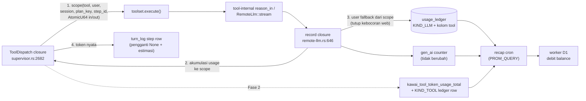

# PLAN — Charge Usage Token dari Tool Calling

**Status:** implemented (Fase 1 + 2) · **rev3 — 2026-10-19**: harga jadi model revenue bertingkat (keputusan pemilik) — lihat §10 Q2.
**Scope fase ini:** atribusi per-tool atas seluruh konsumsi token LLM yang dipicu sebuah tool call (Fase 1), plus opsi harga app-token per tool call (Fase 2). Debit tetap lewat jalur recap → worker yang sudah ada — **client tidak pernah mendebit** (invarian `PLAN-qris-topup.md` §15).

---

## 0. Keputusan desain

| # | Keputusan | Alasan / bukti |
|---|---|---|
| D1 | **Satu titik ukur: `ToolDispatch` closure** di `build_registry_from_toolset` (`src-tauri/src/supervisor.rs:2682-2695`) — setiap step tool supervisor lewat sini | Choke point tunggal yang sudah ada (canonical name, memo, deadline, `log_turn`); tidak ada jalur dispatch kedua yang perlu dirawat |
| D2 | **Atribusi via scope per-task** (`tokio::task_local!` di `kawai-telemetry`), bukan parameter baru di tiap tool | `reason_in` (`crates/foundation/remote-llm/src/reason.rs:47-63`) dipanggil dari ≥9 crate tool tanpa konteks step; menyuntik parameter berarti menyentuh semua call site. `grep tokio::spawn crates/toolsets crates/engines` → **nol hasil** — alur tool same-task, task_local aman hari ini (jaga dengan tes, lihat R2) |
| D3 | **Ledger dapat kolom `tool`** (migrasi `0038_usage_tool.sql`), bukan prefix pada `role` | `role` = Agent Observability grouping key (`remote-llm/src/lib.rs:413`); mengotorinya dengan `tool:` merusak grouping UI. Ledger adalah sumber penagihan fase sqld + sasaran cross-check karakter (`usage.rs` header) — kolom eksplisit bisa di-`GROUP BY` |
| D4 | **Tidak ada counter Prometheus berlabel tool** | Aturan kardinalitas sendiri: billing counter hanya label low-cardinality; `model`/`agent.version` saja sudah dibuang dari counter (`telemetry/src/lib.rs:400-411`). Ratusan nama tool × user = ledak seri. Breakdown per tool hidup di ledger lokal + `turn_log` |
| D5 | **Fase 2 (harga per tool) menumpuk di atas tagihan LLM pass-through** — bukan menggantikan | LLM tool-internal sudah tertagih via `gen_ai_client_token_usage_total`; surcharge = margin tool (preseden: media Civitai membebankan 1,2× margin infra di atas Buzz — `logic/civitai.rs:29-33`). Opsi pass-through (reroute generation tool-scope ke counter terpisah) dicatat sebagai keputusan terbuka §10 |
| D6 | **Fase 1 tidak mengubah total tagihan** — murni atribusi + angka nyata di `turn_log` + perbaikan kebocoran atribusi web | Total per user di recap dihitung dari counter yang sama; kolom/label baru tidak menambah baris tagihan |
| D7 | **Perbaiki kebocoran atribusi web di jalur yang sama**: `record` closure memakai `user_id` dari scope saat pool dibangun tanpa `with_user` | Hari ini baris ledger **dibuang** dengan eprintln `"generation WITHOUT user attribution"` (`remote-llm/src/lib.rs:676`) → tool call di web tidak tertagih sama sekali. Scope dipasang di choke point yang selalu memegang `user_id` |
| D8 | **Harga tool = tabel kode** (`logic/tool_pricing.rs`), **nol env var baru** | Aturan repo: tidak menambah env var tanpa kebutuhan. Free tool → `None` (tidak ditagih). Override harga per-deploy menunggu kebutuhan nyata |
| D9 | **Balance gate tetap pre-run saja** (`plan_task`, fail-closed — `supervisor.rs:559-580`) | Recap lag membuat enforcement mid-run tidak pernah eksak; menambah cek worker per-step = latensi tanpa kepastian. Tidak diubah fase ini |

---

## 1. Kondisi saat ini (bukti di kode)

| Fakta | Bukti |
|---|---|
| Semua panggilan remote LLM (planner, sintesis, one-shot di dalam tool) sudah tertagih: baris `usage_ledger` KIND_LLM + counter `gen_ai_client_token_usage_total{user.id}` — ditulis di satu closure `record` | `crates/foundation/remote-llm/src/lib.rs:646-700` (`kawai_db::record_usage` + `kawai_telemetry::record_generation`) |
| Tool-internal LLM lewat `reason_in` → pool yang sama → closure `record` yang sama | `crates/foundation/remote-llm/src/reason.rs:47-63`; pemakai: `analytics-tools/answer.rs:233-238`, `engines/agent/explain_tool.rs:140-145`, `engines/desk/tool.rs`, `engines/youtube/tool.rs`, … |
| Baris ledger LLM **tanpa** `user_id` dibuang (web; desktop tertutupi fallback `CURRENT_USER`) | `remote-llm/src/lib.rs:659-676` (eprintln skip); fallback: `telemetry/src/lib.rs:415-443` ("tool one-shots via `reason`" — desktop saja) |
| `turn_log` per step: `provider="supervisor"`, nama tool, latensi, `input_tokens: None`, output = **estimasi chars/4** | `supervisor.rs:2711-2727`; kontrak: `foundation/db/src/db.rs:770-820`; `usage.rs` header: "carries a character-length/4 ESTIMATE … rather than a provider-reported token count" |
| Ledger punya 3 kind: `llm` / `embed` / `media`; media menagih `billed_tokens` dan dikecualikan dari total token | `foundation/db/src/usage.rs:37-41,53`; `usage_window` media `:289`; `usage_by_session` mengecualikan media `:323` |
| Recap menagih dari Prometheus: `sum by (user_id) ({__name__=~"gen_ai_client_token_usage_total\|kawai_media_token_usage_total", job="kawai"})` + cross-check ledger per window | `crates/ops/recap/src/main.rs:50-56,425-433`; nama counter dikunci tes `billing_metric_names_match_recap_promql` (`telemetry/src/lib.rs:974-985`) |
| Preseden metering app-token non-LLM: `meter_media` → dua sink (telemetry + ledger), tanpa gagalkan caller | `src-tauri/src/logic/civitai.rs:86-101` |
| Migrasi terakhir `0037_venue_positions` → milik saya `0038_usage_tool`; runner transaksional + tes wajib | `crates/foundation/db/src/db_migrations.rs:342-389` |
| Step sudah memuat link ke generation-nya di telemetri (`linked_generation_ids` via `last_generation_id(conversation, tool)`) | `supervisor.rs:3020-3053` — join konseptual step↔generation sudah ada, tinggal diangkat ke ledger |

---

## 2. Arsitektur target



**Prinsip:** ukur di satu tempat (choke point), sumbangkan usage dari satu tempat (closure `record`), tagih lewat jalur lama (recap). Tidak ada penulis ledger/counter kedua.

---

## 3. Fase 1 — Scope atribusi + token nyata di `turn_log` (🟢 tanpa perubahan tagihan)

### 3.1 `ToolChargeScope` — `crates/foundation/telemetry`

```rust
pub struct ToolCharge {
    pub tool: String,
    pub user_id: String,
    pub session_id: i64,
    pub llm_in: AtomicU64,
    pub llm_out: AtomicU64,
}
tokio::task_local! { static CHARGE: Arc<ToolCharge>; }
// enter(f) → scope guard; current() → Option<&Arc<ToolCharge>>
```

- `sync` + `Copy`-friendly: closure `record` di remote-llm adalah closure sinkron di dalam stream — baca `llm_in.fetch_add` saat event `Done`.
- Rumah di `kawai-telemetry` (pola global atribusi `CURRENT_USER` sudah di sana, `telemetry.rs:415-443`); remote-llm dan supervisor sudah bergantung padanya.

### 3.2 Remote-llm `record` closure — `crates/foundation/remote-llm/src/lib.rs:646-700`

Saat `ToolCharge::current()` aktif:

1. `llm_in/llm_out.fetch_add(usage)` — akumulasi per step.
2. **User fallback**: `user_id` None → pakai `charge.user_id` (D7 — tutup kebocoran ledger web; eprintln hilang untuk jalur tool).
3. **Kolom `tool`**: `UsageRecord.tool = Some(charge.tool)` (butuh field baru + tulis di `write_rows`).
4. Counter `gen_ai` **tidak berubah** (D4, D6).

### 3.3 Migrasi `0038_usage_tool.sql`

- `ALTER TABLE usage_ledger ADD COLUMN tool TEXT;` (+ indeks `(user_id, tool)` bila cross-check per-tool jadi kebutuhan — awal: tanpa indeks, volume kecil).
- Field `UsageRecord.tool: Option<String>` + mapping di `write_rows` (`usage.rs:160-173`).
- Tes wajib di modul `tests` `usage.rs` (pola `0031`: round-trip + NULL ≠ 0).

### 3.4 `turn_log` step row — `supervisor.rs:2713-2727`

- Keluar scope → baca akumulasi: ada panggilan remote (`llm_in+llm_out > 0`) → `input_tokens/output_tokens` = angka provider nyata; tidak ada → status quo (`None` + estimasi chars/4, tool lokal murni gratis).
- `finish_step_telemetry` (`:3020`) tidak berubah — `linked_generation_ids` sudah benar.

### 3.5 `reason_in` tanpa conversation — opsional (dilakukan kalau murah)

One-shot tool hari ini hanya set `with_agent`; dengan scope aktif, `conversation_id` bisa diisi `format!("step:{session}:{step_id}")` agar thread UI mengelompokkan generation tool di bawah run — **hanya kalau** tidak mengubah perilaku grouping yang sudah bergantung padanya. Default: lewat.

---

## 4. Fase 2 — Harga app-token per tool call (🔴 keputusan produk dulu — §10)

### 4.1 Kind + harga

- `pub const KIND_TOOL: &str = "tool";` di `usage.rs` (samping `KIND_MEDIA`); menagih `billed_tokens`, token LLM dibiarkan `NULL` (disiplin yang sama dengan media, `usage.rs:53`).
- `src-tauri/src/logic/tool_pricing.rs`: `pub fn tool_price(tool: &str) -> Option<u64>` — tabel kode, app-token per panggilan (1 token = Rp 0,01). Tool lokal/on-device & read-only murah → `None`.

### 4.2 Meter di choke point — `supervisor.rs`, setelah `toolset.execute` sukses

```rust
if let Some(price) = tool_pricing::tool_price(&name) {
    kawai_telemetry::metric_counter("kawai_tool_token_usage_total", price,
        vec![("user.id".into(), db_user_id.clone())]);          // TANPA label tool (D4)
    kawai_db::record_usage(&db_user_id, UsageRecord {
        kind: KIND_TOOL.into(), role: Some("supervisor-step".into()),
        provider: Some("kawai".into()), billed_tokens: Some(price as i64),
        session_id: Some(db_session_id), tool: Some(name.clone()),
        ..Default::default() });
}
```

- Pola = `meter_media` (`civitai.rs:86-101`): dua sink, fire-and-forget, tidak pernah menggagalkan step.
- Charge hanya saat step `Completed` — retry yang gagal tidak ditagih (memo hit tidak double-charge: cek `memo.get` return lebih awal sebelum charge).

### 4.3 Recap + cross-check

- `PROM_QUERY` (`crates/ops/recap/src/main.rs:56`) → `{__name__=~"gen_ai_client_token_usage_total|kawai_media_token_usage_total|kawai_tool_token_usage_total", job="kawai"}`.
- Perbarui kedua sisi tes pengunci `billing_metric_names_match_recap_promql` (`telemetry.rs:974-985`) — satu commit.
- `usage_window` (`usage.rs:289`): KIND_TOOL masuk bucket `media_tokens`-semacam (`billed_tokens` saja, tidak ikut total token) — ganti nama field menjadi `app_token_*` atau tambah field; **pilih tambah field** `tool_tokens` (jangan menyalaharti media).
- `usage_by_session` (`usage.rs:323`): `kind <> 'media'` → `kind NOT IN ('media','tool')` untuk baris token, + baris terpisah untuk surcharge bila cost-line run mau menampilkannya.

### 4.4 UI (minimal)

- Cost line run (`usage_by_session` consumer) menambah “+ N token tool” bila > 0. Tanpa halaman baru.

---

## 5. Konfigurasi & secret

**Nol env var baru, nol secret baru** (D8). Harga = tabel kode. Tidak ada baris CREDENTIALS.md baru.

---

## 6. Risiko & mitigasi

| # | Risiko | Mitigasi |
|---|---|---|
| R1 | **Double-billing Fase 2**: tool ditagih harga tetap *plus* token LLM-nya yang sudah tertagih via `gen_ai` | Disengaja (margin, D5) — dokumentasikan di tabel harga. Alternatif pass-through: §10 keputusan terbuka |
| R2 | `task_local` tidak menyeberang `tokio::spawn` — scope hilang untuk tool yang spawn | Sudah diverifikasi nol `tokio::spawn` di `crates/toolsets` + `crates/engines`. Jaga: tes yang men-assert scope terbaca dari closure `record` untuk 1 tool per kategori; bila tool spawn masuk, ia jatuh graceful ke perilaku hari ini (fallback user + `tool = NULL`) — tidak pernah salah tagih, hanya kurang atribusi |
| R3 | Scope bocor ke step lain (enter tanpa exit di error path) | Guard RAII (`enter` return guard; pop on drop); tes: dua step serial, token step-1 tidak muncul di step-2 |
| R4 | Estimasi chars/4 `turn_log` dipakai orang sebagai “token” → angka berubah makna setelah Fase 1 | Kolom sama, semantik jadi lebih akurat; `turn_log_report` (kalibrasi hybrid) membandingkan provider-reported vs estimasi — justru itu yang dirapikan. Catat di commit message |
| R5 | Recap cross-check karakter ledger vs telemetri terganggu kolom baru | Kolom `tool` ortogonal terhadap cross-check (per-kind token). Jalankan `recap --dry-run` sebelum & sesudah di data dev — delta harus 0 di Fase 1 |
| R6 | Tool yang tidak lewat choke point supervisor (desktop `local_chat` loop, `litert`) tidak ter-scope | Sesuai desain: tier lokal gratis (D5/D6); Fase 1 target = supervisor/web transport. `local_chat` mengintersepsi subagent sebelum ToolSet (`engines/agent/subagents.rs`) — jalur cloud-nya tetap tertagih via `gen_ai` seperti hari ini |

---

## 7. Verifikasi (per lapisan)

```sh
# Ledger + migrasi
cargo test -p kawai-db            # round-trip 0038: tool terisi, NULL ≠ 0, billing tak berubah
cargo test -p remote-llm          # record closure: scope aktif → akumulasi + user fallback + kolom tool
cargo test -p kawai-telemetry     # billing_metric_names_match_recap_promql (Fase 2: +kawai_tool_…)

# Supervisor
cargo test -p kawai               # (suite yang ada) + tes baru: step 2 tool serial → token terpisah (R3);
                                  #  memo hit → tidak ada baris KIND_TOOL (4.2)

# Recap (dev data)
cargo run -p recap -- --dry-run   # Fase 1: delta per user == 0 vs sebelum (R5)
                                  # Fase 2: surcharge muncul sebagai baris 'usage' di balance_ledger

# Ujung-ke-ujung (manual, dev)
#   jalankan 1 goal supervisor dgn step analytics (NL2query = reason_in):
#   1. sqlite usage_ledger → baris LLM baru berkolom tool='data_query_nl' (sebelumnya NULL)
#   2. turn_log step → input_tokensprovider-reported (bukan NULL)
#   3. worker /billing/history → debit sama persis dgn pra-patch (Fase 1)
#   4. build web: reason_in tanpa user di step → baris ledger ADA (dulu: dibuang)
```

Semua wajib hijau sebelum commit; `cargo check` + `cargo check --features web` untuk tiap sentuhan.

---

## 8. Non-goals (fase ini)

- Enforcement balance mid-run per step (D9 — tetap pre-run fail-closed).
- Harga berbasis model / per-token markup dinamis.
- Dashboard per-tool cost di frontend (data sudah ada di ledger; UI menyusul bila diminta).
- Menagih tool di tier `local_chat` desktop (gratis by design, R6).
- Refund/kompensasi step gagal.

---

## 9. Urutan kerja

1. **Fase 1a** — migrasi `0038_usage_tool.sql` + `UsageRecord.tool` + tes (`kawai-db`).
2. **Fase 1b** — `ToolChargeScope` (`kawai-telemetry`) + closure `record` remote-llm (akumulasi, fallback user, kolom tool) + tes.
3. **Fase 1c** — pasang scope di `ToolDispatch` closure + `turn_log` nyata + tes serial-step (R3).
4. **Verifikasi Fase 1** (§7 baris 1-3 + manual 1-2-4) → commit.
5. **Fase 2** (setelah §10 dijawab) — `KIND_TOOL` + `tool_pricing.rs` + meter di choke point + recap regex + tes pengunci + `usage_window`/`usage_by_session` + cost line UI.
6. **Dokumen same-commit**: `docs/` halaman billing (bila ada) + catatan kolom `tool` di header `usage.rs` sudah disentuh di 1a.

---

## 10. Keputusan (Fase 2 dijalankan — rev2, 2026-10-19)

| # | Keputusan | Hasil |
|---|---|---|
| Q1 | Model tagihan Fase 2 | **(a) Surcharge** di atas pass-through LLM (D5) — diimplementasi |
| Q2 | Daftar harga | **(rev3 — keputusan pemilik: REVENUE, bukan cost-recovery)** semua tool call kena surcharge bertingkat — 1.000 side-effect (`cli_run`, `composio_execute`), 500 placement order, 250 generasi/authoring, 150 `web_read`, **100 default** (Rp 1/panggilan); `FREE` set (19 tool) = meta/lokal murni & baca data sendiri — satu-satunya yang gratis. Tabel: `logic/tool_pricing.rs` (`FREE` const + tier match), test `tiers_are_distinct_and_ordered` mengunci urutan tier |
| Q3 | `reason_in` conversation key per step | **Skip** (§3.5 default) — grouping UI tidak diubah |

Status: Fase 1 + Fase 2 **terimplementasi dan terverifikasi** (§7). Sisa: angka harga final (Q2) dan `recap --dry-run` pada data dev saat cron dijalankan berikutnya.
