# Perbandingan Integrasi LiteRT-LM — kawai vs flutter_edge_ai vs flutter_litert

**Tanggal:** 2026-11-17
**Status:** Studi perbandingan tiga checkout yang ada di workspace; satu temuan
utamanya (cancel mid-generation) sudah diadopsi dan ter-ship di kawai (lihat §7).
**Objek:** `kawai/` (Rust), `flutter_edge_ai/` (monorepo Dart, paket inti
`packages/flutter_edge_ai_litertlm` v1.20.1), `flutter_litert/`
(`google-ai-edge/flutter_litert` v4.2.0).

---

## 1. Premis: flutter_litert BUKAN integrasi LiteRT-LM

Grep `litertlm|litert_lm|LitertLm|conversation|prefill|tokenizer|gemma|kv_cache`
di seluruh tree `flutter_litert/` menghasilkan **nol hit kode**. Itu plugin
inferensi **LiteRT (TFLite)** biasa — fork `tflite_flutter` + jalur LiteRT Next
`CompiledModel` — untuk model vision-style `.tflite`. Satu-satunya sentuhan ke
LiteRT-LM adalah caveat ko-eksistensi: opsi untuk **tidak** membundel
`libLiteRt` agar tidak menabrak runtime LiteRT-LM milik app lain
(`linux/CMakeLists.txt:52-60`, `windows/CMakeLists.txt:38`,
`CHANGELOG.md:145`).

Konsekuensinya: perbandingan implementasi LM yang sesungguhnya adalah
**kawai vs `flutter_edge_ai_litertlm`**; `flutter_litert` relevan hanya sebagai
(1) bukti independen bahwa GPU stack ponsel (OpenCL Adreno) bekerja untuk
model generik, dan (2) referensi pola policy-ladder `auto`/`gpuWithCpuFallback`
berbasis `isFullyAccelerated`.

## 2. Subjek perbandingan

| | kawai | flutter_edge_ai_litertlm | flutter_litert |
|---|---|---|---|
| Bahasa / posisi | Rust; crate `local-llm/` (orkestrasi) + `cognee-litert-lm/` (binding) | Dart; paket plugin dalam monorepo | Dart; plugin LiteRT non-LM |
| Sumber engine | Fork vendored `cognee-litert-lm/vendor/LiteRT-LM` = upstream `google-ai-edge` main + patch kawai (`842b293b` kGpu\|kCpu fallback, C API embedding standalone, sentencepiece macOS) | Prebuilt tarball SHA256-pinned dari rilis `native-v*`, di-pin ke upstream **v0.19.0** (`771b06e1`, C API 1.0) + patch build (`patch_c_api.sh`, 1182 baris, bagian bernomor s.d. §27) | Runtimes LiteRT 2.3.2 dibundel di plugin; opsi Play-services runtime |
| Target API | C API yang sama: `litert_lm_engine_settings_set_*`, `session_config_create`, `conversation_send_message_stream` | sama | — |

## 3. Arsitektur binding

```mermaid
flowchart TB
  subgraph kawai
    A1[src-tauri commands/web<br/>Tauri Channel + SSE] --> A2[local-llm crate<br/>gate · epoch · ladder · preflight · tool loop] --> A3[cognee-litert-lm<br/>bindgen FFI + RAII] --> A4[vendored fork<br/>upstream main + kGpu&#124;kCpu patch]
  end
  subgraph flutter_edge_ai
    B1[flutter_edge_ai core<br/>SPI install/session/catalog] --> B2[flutter_edge_ai_litertlm<br/>load plan · virtual sessions · stream proxy] --> B3[ffigen bindings v0.19.0<br/>+ hand-written client FFI] --> B4[prebuilt tarballs<br/>patch_c_api.sh §1–§27]
  end
  subgraph flutter_litert
    C1[Interpreter / CompiledModel<br/>+ async isolate dispatcher] --> C2[ffigen TFLite + litert_ffi.dart<br/>hand-written Next FFI] --> C3[LiteRT 2.3.2 runtimes<br/>bundled / Play services]
  end
```

- **kawai** — bindgen *at build time* dari header fork `c/engine.h`
  (`cognee-litert-lm/src/ffi.rs` meng-include `OUT_DIR/bindings.rs`); wrapper
  RAII (`Engine`, `Conversation`, `OptionalArgs`, `ThinkingConfig`, …) di
  `engine.rs`/`conversation.rs`/`session.rs`. Dylib di-bundle manual per
  platform (`scripts/bundle-litert-dylibs.sh`, `scripts/stage-litert-android.sh`).
- **flutter_edge_ai** — ffigen *pre-generated* + supplemental hand-written FFI
  (`lib/src/ffi/litert_lm_client.dart`, ~4400 baris: load-order antar-library,
  stream proxy `stream_proxy_create_v1`, realignment std-handle Windows).
  Distribusi lewat **Native Assets** `hook/build.dart` — tarball prebuilt
  SHA256-pinned untuk 6 ABI.
- **flutter_litert** — ffigen TFLite C API + hand-written `litert_ffi.dart`
  untuk LiteRT Next (ABI `LiteRtLayout` di-pin 68/72 byte, bitfield tidak
  didukung `dart:ffi`).

## 4. Perbandingan per dimensi

| Dimensi | kawai | flutter_edge_ai_litertlm | flutter_litert |
|---|---|---|---|
| Engine load | Ladder saat build (`load_attempts()`): desktop GPU + halving K/V; Android GPU@budget → CPU@budget → CPU halving → floor 2048; klasifikasi `is_allocation_failure` | Load plan **dibaca dari file** sebelum engine ada (`litertlm_load_plan.dart`): NPU → GPU → CPU dari bundle stamp; 4 stack NPU (QNN, Tensor G5/G6, MediaTek, OpenVINO) | Policy ladder `CompiledModel`: strict `{gpu}` → retry CPU; NPU CoreML/QNN; desktop WebGPU |
| GPU backend | Metal desktop; Android GPU-first lewat patch fork `kGpu\|kCpu` — op yang tak ter-cover jatuh ke CPU | Metal Apple, OpenCL Android (re-add via patch §19), WebGPU/Dawn desktop, DXC Windows | Metal/CoreML/WebGPU — jalur vision |
| KV budget | Default **16384 desktop / 4096 Android**, ceiling 32003 (Gemma 4), floor 2048 | Clamp min 1024; NPU bundle bawa `cache_length` sendiri; registry `fixed_max_tokens` per model (mis. 1280) | — |
| Preflight | `engine.count_tokens` + `conv.token_count` **sebelum** generate → reject + clamp output cap; auto-reset sekali saat overflow | Cek `liteRtLmPrefillFits` (panjang prefill-signature) | — |
| Streaming | Callback C fire-and-forget → done-channel ber-poll (tick 100ms) → tokio mpsc → `async_stream` → `LocalChatEvent` | `NativeCallable` stream proxy; prefill di isolate terpisah; native mutex per turn (`heldUntilNativeEnd`) | — (async inference via isolate + `AsyncLock`) |
| Cancel mid-generation | **Ter-wire** (§7): consumer hilang → `cancel_process` + conversation diganti fresh | Penuh: cancel native + retry 20ms saat prefill + patch §16 `rewind_cancelled_turn` | — |
| Multi-session | 1 engine + 1 conversation global; FIFO `GenerationGate` (cancel per-request); epoch guard cegah stale restore; manifest per `agent_id:session_id` untuk delta-prefill | Upstream max 1 conversation → **virtual-session multiplexer**: teardown/rebuild + replay `messages_json`, tombstone, deferred teardown | — |
| Tool calling | Prompt-based: `tools_json` via `ConversationConfig.set_tools`; loop `parse_tool_calls` → kawai-tools | Setter `tools` + history preface; plus **structured output** LLGuidance constraint | — |
| Thinking | `OptionalArgs.set_thinking` + slot toggle; part `thought` → event `Thinking` | `extra_context {"enable_thinking": bool}` + thinking token budget | — |
| Multimodal | image/audio base64 part; `max_num_images`; `describe_image_bytes` (conversation ephmeral) | Vision/audio encoder backends + `MultimodalOrder`; web text-only | — |
| LoRA | Tidak dipakai (Conversation API tidak expose SessionConfig) | Setter ada di bindings tapi Dart throw `UnsupportedError` (FFI & web) | — |
| Model sourcing | `ensure_model`: download HuggingFace runtime + `model_candidates` | `installModel().fromNetwork/fromHuggingFace/fromAsset` + registry ~35 YAML pinned sha256 + evidence benchmark per-device | Asset saja |
| Web | Tidak ada | `dart:js_interop` ke `@litert-lm/core` 0.18.0 (text-only) | `@litertjs/core` (WASM, non-LM) |

## 5. Konvergensi — dua integrasi LM sampai di titik sama secara independen

1. **Satu live conversation di upstream** — edge_ai bangun multiplexer virtual
   session; kawai bangun FIFO gate + take/restore epoch-guarded.
2. **Drop engine mid-generation = segfault** — kawai: conversation diambil dari
   slot, `unload_model`/`reset_conversation` ditolak saat generasi jalan;
   edge_ai: `close()` cancel lalu tunggu native end sebelum delete (repo
   mereka: issue #3771, #364).
3. **GPU-first + CPU fallback di Android**, E4B @4096 KV terbukti di kedua
   sisi (registry `flutter_edge_ai/model_registry/derived/*` device-tested
   `max_num_tokens: 4096`; kawai mengadopsinya sebagai default Android).
4. **Patch engine diperlukan di titik yang sama**: sentencepiece (kawai:
   hdrs-check macOS; edge_ai: NUL-byte BPE §17), GPU accelerator set (kawai:
   `kGpu|kCpu`; edge_ai: OpenCL re-add §19), sampler Windows.
5. `send_message_stream` fire-and-forget wajib di-jembatani eksplisit —
   edge_ai: handshake native end; kawai: done-channel + watchdog.

## 6. Yang hanya dimiliki satu pihak

| kawai saja | flutter_edge_ai saja |
|---|---|
| Preflight token accounting + usage per generasi (`LocalGenerationUsage`) | Cancel native + patch rewind KV turn batal (§16) |
| Auto-reset-on-overflow transparan | Virtual multi-session dengan replay history |
| Epoch guard + manifest delta-prefill (agen multi-session berbagi 1 engine) | Structured output via LLGuidance constraint |
| Embeddings satu stack dengan LM (`EmbeddingGemma` on-device, dipakai RAG) | NPU 4 vendor + load plan dari file bundle |
| Watchdog callback + poll cancel (lapisan anti-hang generasi) | Web (`@litert-lm/core`), Native Assets, model registry ber-evidence |
| Transport ganda (Tauri Channel + Axum SSE) dari stream yang sama | Workaround sampler Windows/Linux, gpu_registry dlopen App-Store |

## 7. Yang sudah diadopsi kawai: cancel mid-generation (2026-11-17)

Sebelum adopsi, cancel di kawai hanya memutus consumer — native generation
jalan sampai selesai (dibatasi watchdog 600s), conversation hilang dari slot
sampai reload, dan engine terus burn CPU setelah UI menampilkan turn sebagai
cancelled. Sekarang (`local-llm` @ `ec64278`, parent @ `767f98a` + `709fbd30`):

- `CancelOnDrop` guard per iterasi `local_chat`: consumer hilang (Tauri
  `cancel_stream`, SSE web putus, consumer dibatalkan) → flag → blocking task
  mengirim `Conversation::cancel_process`.
- Task self-restoring: conversation di-restore di **dalam** task, bahkan saat
  consumer sudah gone. Turn yang dibatalkan **diganti conversation fresh**
  (bukan restore) + epoch bump — menghapus prefix parsial dari KV dan
  mengosongkan manifest tanpa patch rewind di fork.
- `cancel_process` memberi grace 60s untuk callback terminal; wait tidak pernah
  berakhir dengan engine thread masih mid-generation.
- Swap conversation-fresh diekstrak ke `fresh_conversation_from_engine()`,
  dipakai bersama `reset_conversation` (satu sumber kebenaran).
- Skenario regresi permanen di `src-tauri/examples/local_llm_smoke.rs`: drop
  stream pasca-token pertama → wajib epoch bump ≤15s → turn berikutnya tetap
  streaming.

**Bukti e2e (smoke model produksi Gemma 4 E4B, GPU, 2026-11-17):**
`cancel_process sent (generation_id=2)` → decode berhenti (outcome ok) →
`conversation replaced in 0.1s` → preflight turn berikutnya `current=0` →
turn streaming normal. Gate: `cargo check` (default/web/litert) hijau,
28 unit test `local-llm` lolos.

## 8. Yang masih terbuka

1. **Structured output via `ConstraintType`** — binding kawai sudah expose
   LLGuidance constraint (`cognee-litert-lm/src/conversation.rs`), `local-llm`
   belum memakainya. Tidak di-wire otomatis: memaksakan schema ke jalur
   tool-calling berisiko merusak loop `parse_tool_calls` (gate `agent_eval`
   office 19/20 harus di-re-run). Perlu keputusan consumer: alat mana yang
   memang ingin dijamin JSON valid (kandidat: jawaban akhir analytics/
   accounting).
2. **Patch `rewind_cancelled_turn` (edge_ai §16)** — tidak difork sendiri;
   pantau masuk upstream. Setelah cancel-reset (§7), rewind bukan lagi
   kebutuhan korektness — hanya optimasi prefill (menghemat re-prefill penuh
   setelah turn batal).

## 9. Referensi file utama

- kawai: `local-llm/src/lib.rs` (`load_attempts`, `GenerationGate`,
  `CancelOnDrop`, `local_chat`), `cognee-litert-lm/src/{engine,conversation,session}.rs`,
  `cognee-litert-lm/vendor/LiteRT-LM/c/` (C API), fork patch
  `842b293b` (kGpu|kCpu).
- flutter_edge_ai: `packages/flutter_edge_ai_litertlm/lib/src/ffi/litert_lm_client.dart`,
  `lib/src/litert_lm_engine.dart`, `bundle/litertlm_load_plan.dart`,
  `native/litert_lm/patch_c_api.sh`, `hook/build.dart`,
  `model_registry/` (katalog + evidence).
- flutter_litert: `lib/src/compiled_model/compiled_model_native.dart`
  (policy ladder + async dispatcher), `lib/src/bindings/litert_ffi.dart`,
  `patches/` (CoreML NPU, pthreadpool Apple).
